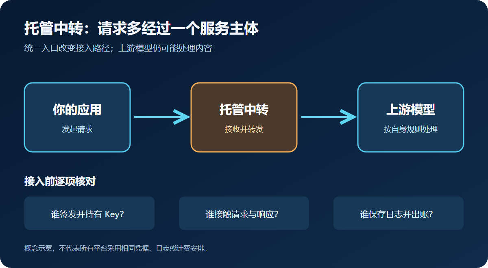

# API中转怎么选？接入路径、计费方式与数据风险

给应用接入大模型时，“API中转”通常指在你的应用与上游模型服务之间加入一层服务，由它接收请求，再转发或路由到上游模型；上游模型提供方仍可能处理内容。它可能统一接口、管理多个上游，也可能代收费用；具体能力取决于服务商，不能只凭“中转”两个字推断。

先做一个选择：只用一家模型、需要直接控制上游账户与合同，优先评估厂商直连；需要在多个模型间切换、愿意把部分请求与账务交给第三方，才评估托管中转；需要统一入口但希望自己掌握上游凭据和部署，评估自管网关。三条路都要验证模型输出、成本与故障处理。

## 先分清三条路：谁持有凭据、谁处理请求

直连时，应用向模型厂商的 API 发送请求，由该厂商按其规则计费和处理数据。托管中转则多一个服务主体：应用先调用中转方，由中转方按配置转发。自管网关也多一层技术组件，但网关由团队部署和运营；它仍可能调用外部模型，不能因此说数据完全留在内部。

“统一 API”不等于“数据只经过一个地方”。托管方可能拿到请求内容、生成结果、用量记录，甚至负责上游密钥；也可能采用用户自带上游密钥。以具体产品为例，[Cloudflare 的 BYOK 文档](https://developers.cloudflare.com/ai-gateway/configuration/bring-your-own-keys/)描述了自带密钥的配置；[OpenRouter 隐私政策](https://openrouter.ai/privacy/)说明请求会发送至所选或路由到的模型提供方。它们证明存在不同安排，不能代替对候选服务逐项核实。团队自己部署网关时，也要管理内部虚拟密钥、权限和上游凭据；[LiteLLM 虚拟 Key 文档](https://docs.litellm.ai/docs/proxy/virtual_keys)展示了一种做法。

| 路线 | 更适合的条件 | 需要自己承担或核对 |
| --- | --- | --- |
| 厂商直连 | 模型供应商少，原生功能和直接合同更重要 | 多厂商接入、切换与统一成本视图由团队处理 |
| 托管中转 | 多模型入口和集中管理有价值，且可接受服务商的条款 | 请求流向、密钥归属、转发方的数据处理、加价和退出路径 |
| 自管网关 | 有运维能力，希望自行控制路由与上游凭据 | 部署、监控、故障恢复、成本数据准确性 |

*图示为概念路径；具体凭据、日志和计费安排以候选服务与上游的文件为准。*

这张表是选择条件，不是性能或安全排名。无论走哪条路，只要请求最终到外部模型厂商，该厂商的处理规则仍然重要。

## 接入前先核对四件事，再写第一行调用代码

第一，锁定要用的**具体模型和接口**。确认模型标识、版本、输入类型、上下文限制及所需功能；“兼容某 API”不自动覆盖流式输出、工具调用或所有参数。对照候选方的文档，而不是按品牌名称猜支持范围。

第二，画出**凭据和请求路径**：应用拿谁签发的 Key？上游 Key 是否交给中转方？请求正文和响应经过哪些主体，日志由谁保存、保留多久？若答案只停留在“加密传输”，仍不足以判断数据处理边界，不能据此放入真实客户输入。

第三，用不含敏感数据的小样本做**最小验证计划**：检查状态码、错误信息、流式行为、超时、重试、用量记录和响应质量，并与直连基线对照。这里提出的是应做的验证，不是本文已完成的实测。[Moduck 开发者概览](https://docs.moduck.ai/zh/overview)和[Moduck 快速开始](https://docs.moduck.ai/zh/quickstart)可用来核对其公开接入说明；账户、模型与权限是否适用，仍要以实际页面及团队验证为准。

第四，先定**退出方法**。把模型名、Base URL 与 Key 放在可替换的配置层；确认余额如何处理、是否能导出用量、出故障时如何回退到直连或另一条路线。切换时仍需重跑业务验收，因为统一接口不保证输出一致。

## 把报价拆成可对账的总成本

选站不能只比较“每百万 token 价格”。先将同一个业务样本拆成输入、输出、缓存命中与未命中、调用次数，并确认计价单位、币种、四舍五入和模型版本。再单列平台费、充值或支付手续费、附加服务费，以及失败重试产生的实际用量。各家的账单口径可能不同，报价表的最低一格不等于你的月账单。

一个不依赖厂商报价的估算式是：**预计模型费用 = 输入量 × 输入单价 + 输出量 × 输出单价**；如有缓存、批处理或其他计价档位，应分别计算，再加上平台与支付费用。假设一次任务平均输入 2,000 token、输出 500 token，每月 10,000 次，那么需要核价的用量是 2,000 万输入 token 和 500 万输出 token。这个例子只是换算用量，不代表任何服务的实价，也没有计入重试。

不同模式的额外费用位置也不同：[OpenRouter 定价页](https://openrouter.ai/pricing)列出积分购买相关费用和模型价格；[Cloudflare 网关定价文档](https://developers.cloudflare.com/ai-gateway/reference/pricing/)将网关服务与其模型推理计费边界分开说明。两者不能拼成“中转行业统一费率”。自管也不等于没有平台成本，部署、日志和人员维护要算进去。网关侧统计可以帮助归因，但应与上游账单核对；[LiteLLM 成本追踪文档](https://docs.litellm.ai/docs/proxy/cost_tracking)提供的是一种追踪方法。

向候选方要一份与你业务样本相符的报价和账单样例，并核对重试、失败请求、余额、退款及价格变化通知；价格或模型版本改变时，按同一业务样本重算。若这些口径说不清，就先不要用“便宜”做结论。

## 用数据要求和退出成本决定是否使用中转

如果应用含敏感客户输入，先问能否接受额外的数据处理主体、日志内容及保留规则。例如，[Cloudflare 日志文档](https://developers.cloudflare.com/ai-gateway/observability/logging/)说明其网关日志可以涉及提示词和响应，且有配置选项；这是该产品的文档事实，不能推导出别家默认记录或默认不记录。候选方若无法清楚说明数据流向、保留、删除及分包方，就暂停真实数据接入。

如果多模型切换是明确需求，且服务方能提供可核实的模型范围、计价口径和退出办法，托管中转值得进入小范围验证。若核心是单一模型的原生功能或直接合同，直连通常更简单。若需要统一入口但团队能承担运维，并希望控制路由与上游凭据，自管网关更值得评估。结论会随着模型范围、数据政策、用量结构、上游价格或团队运维能力变化而改变。

Moduck／模鸭的已确认定位是 AI 模型 API 聚合平台，目标是让开发者更清楚地找到模型、价格和接入信息。这一定位不能证明某个模型当前可用、某个报价适用，也不能替代对日志、权限和实际调用结果的核查。如果 Moduck／模鸭这类聚合平台仍在候选名单里，先对照文档核实具体模型、接口、计价单位与账户条件。可先[阅读开发文档](https://docs.moduck.ai/)。先核对具体模型、价格和账户条件，再决定是否登录获取 Key。若核对后直连或自管更符合要求，就按那个结论走。
